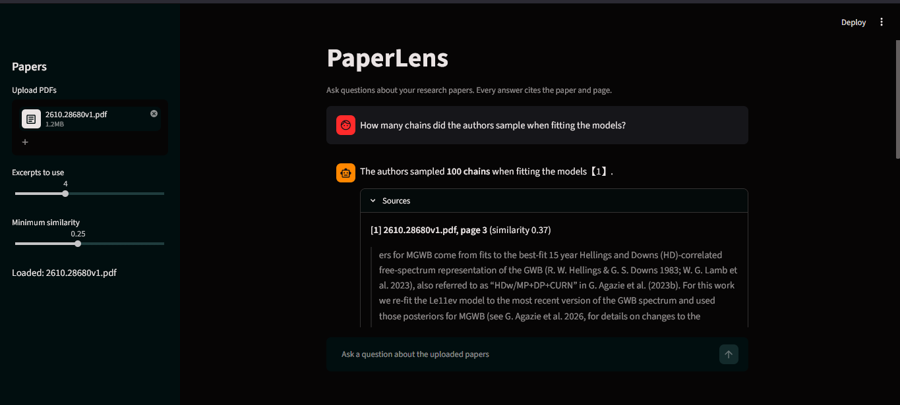

# PaperLens

**Live app:** https://paperlens97.streamlit.app

Ask questions about research papers. Every answer cites the paper and page it came from.



## How it works
1. PDFs are split into chunks; each chunk keeps its paper name and page number.
2. Chunks are embedded locally with `sentence-transformers` and searched by cosine similarity.
3. The top excerpts go to an LLM (Groq) with strict rules: answer only from the excerpts, cite them, or say the answer is not in the papers.

## Quick start
```bash
python -m venv .venv
source .venv/bin/activate          # Windows: .venv\Scripts\activate
pip install -r requirements.txt
cp .env.example .env               # then add your GROQ_API_KEY and GROQ_MODEL
streamlit run app/streamlit_app.py
```
## Evaluation

Evaluated on one real paper (arXiv:2610.28680, 16 pages) with 12 answerable and 3 unanswerable questions. Chunk size 500 characters, overlap 100, top-4 retrieval, minimum similarity 0.25.

| Metric | Result |
|---|---|
| Retrieval hit@4 (right paper and page in top 4) | 11/12 (92%) |
| Refusal by retrieval alone (unanswerable questions) | 2/3 (67%) |
| End-to-end refusal (retrieval + LLM) | 3/3 (100%) |

**Caveats.** The test set is small (15 questions), and chunk size was tuned on these same questions, so the numbers are likely optimistic. Only retrieval and refusal were measured; answer correctness was checked by hand on a few questions, not systematically.


## Limitations
- Text only: tables, equations and figures in PDFs are not understood.
- Scanned PDFs (images) have no extractable text and need OCR first.
- The similarity threshold is tuned on a small question set.
- Retrieval depends on wording: a question that uses different words from the paper can miss the right passage.
- Smaller chunks improved hit rate but can split a number from its context (one question regressed after the change).
- Tables, equations and figures in PDFs are not understood.

## Roadmap
- [ ] Persist the index between sessions
- [ ] Re-ranking of retrieved excerpts
- [ ] OCR support for scanned papers
- [ ] Custom web frontend (FastAPI backend with a dedicated UI)
